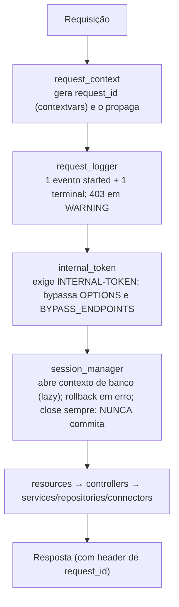
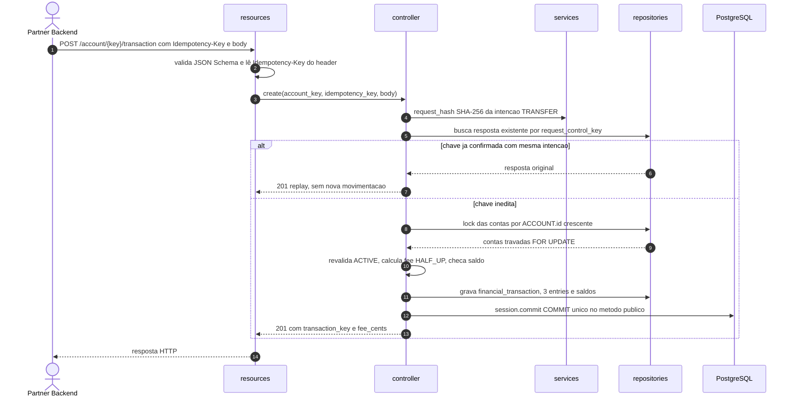

# Arquitetura em camadas — BaaS Simplificado

**Bootcamp QI Tech 2026** · **Autores:** João Vitor Miranda Sousa · Mohamad Ahmad Barakat

**Versão:** P2-Final · schema e código conforme `main`

**Documentos relacionados:** [RFC](RFC.md) · [ERD](ERD.md) · [ROTAS](ROTAS.md) · [FLUXOS](FLUXOS.md) · [Segurança](SEGURANCA.md) · [CI/DevSecOps](CI-DEVSECOPS.md)

> Cada afirmação deste documento é verificável contra `src/`. Caminhos e papéis
> foram conferidos na rodada P2-Final.

## 1. Visão macro

A aplicação é um serviço HTTP em **FastAPI** com persistência em **PostgreSQL**
(via **SQLAlchemy**), validação de entrada por **JSON Schema** e integração de
análise cadastral por **HTTP** (provedor simulado com **MockServer** em
desenvolvimento/testes). O desenho é em camadas, da borda para o núcleo:

```text
Requisição HTTP
   │
   ▼
┌───────────────────────────────────────────────────────────────────────┐
│ middlewares/   request_context → request_logger → internal_token →      │
│                session_manager   (ordem efetiva de processamento)       │
└───────────────────────────────────────────────────────────────────────┘
   │
   ▼
┌───────────────────────────────────────────────────────────────────────┐
│ resources/     camada HTTP: valida (JSON Schema), chama controller,     │
│                monta JSONResponse e define o status                     │
└───────────────────────────────────────────────────────────────────────┘
   │
   ▼
┌───────────────────────────────────────────────────────────────────────┐
│ controllers/   regras de negócio + FRONTEIRA TRANSACIONAL (COMMIT único)│
└───────────────────────────────────────────────────────────────────────┘
   │                                   │
   ▼                                   ▼
┌─────────────────────────┐   ┌──────────────────────────────────────────┐
│ services/ (puro)        │   │ repositories/ + models/ → PostgreSQL       │
│ transfer_fee (HALF_UP)  │   │ (SQLAlchemy; locks FOR UPDATE; lookups)    │
│ transaction_hash SHA256 │   └──────────────────────────────────────────┘
└─────────────────────────┘
   │
   ▼
┌───────────────────────────────────────────────────────────────────────┐
│ connectors/    HTTP externo com timeout obrigatório                     │
│                (client_analysis_connector → Analysis Provider/MockServer)│
└───────────────────────────────────────────────────────────────────────┘
   │
   ▼
dtos/ projeta a resposta  →  Resposta HTTP
```

## 2. Camadas e responsabilidades

Diretórios sob `src/` (todos confirmados no repositório):

| Camada / arquivo | Papel |
|---|---|
| `app.py` | *Composition root*: `create_app()` registra os 4 middlewares, declara as 10 rotas (R01–R10) e os *error handlers*; `main()` roda `check_variables()`, `error_verification()`, `setup_logging()`. Em `APP_ENV=production`, desliga `/docs`, `/redoc` e `/openapi.json` (SEC-05). |
| `constants.py` | Configuração por ambiente: `INTERNAL_TOKEN`, `DATABASE_URL`, timeouts de banco, `ANALYSIS_PROVIDER_*`, `BANKSLIP_API_*`, `BYPASS_ENDPOINTS` (`["/", "/health_check"]`), `check_variables()`. |
| `database.py` | Engine/sessão SQLAlchemy; `Context` por requisição via `contextvars`; `connect_args` aplicam `lock_timeout` e `statement_timeout` por conexão. |
| `middlewares/` | `request_context`, `request_logger`, `internal_token`, `session_manager` (ver §3). |
| `resources/` | Camada HTTP: um *resource* por domínio (`client`, `client_analysis`, `account`, `transaction`, `health_check`). Mapeia verbo→controller, valida JSON Schema, monta `JSONResponse` e define o status (201/200/204…). |
| `controllers/` | Regras de negócio e **fronteira transacional**. `base_controller` guarda `context`/`session`/`logger`. O `COMMIT` único mora no método público do controller. |
| `services/` | Lógica **pura, sem I/O**: `transfer_fee` (tarifa PF/PJ com `HALF_UP`) e `transaction_hash` (SHA-256 da intenção canônica). Extraídas de `controllers/` em P1-C (COD-09) para remover chamadas entre camadas irmãs. |
| `repositories/` | Acesso a dados por SQLAlchemy: leitura, escrita, locks `FOR UPDATE` ordenados, resolução texto↔lookup. |
| `connectors/` | HTTP externo: `rest_connector` (base, **timeout obrigatório**, encaminha `INTERNAL-TOKEN` quando configurado), `client_analysis_connector`, `bankslip_connector`. |
| `models/` | Modelos ORM de domínio e das 7 lookups. |
| `dtos/` | Projeções de resposta (`obj_to_response`) — não expõem IDs internos nem campos não contratados. |
| `errors/` | `QIException` base, catálogo (`base_error`, `client_errors`, `account_errors`, `transaction_errors`) e `handlers`; `error_verification()` falha no startup se dois erros compartilharem código. |
| `schemas/` | Arquivos JSON Schema de validação das rotas não-GET e do extrato. |
| `utils/` | `logger` (allowlist estruturada), `request_context`, `database_errors` (classifica timeouts por SQLSTATE), `document_number`, `schema_handler`. |

## 3. Middlewares — ordem e porquê

Registro em `src/app.py` (o FastAPI/Starlette executa o **último registrado
primeiro**, então a ordem efetiva de processamento é a inversa do registro):



Razões do ordenamento (documentadas em `app.py`):
- **request_context antes do log** para que toda linha de log tenha o `request_id`.
- **log antes do token** para que o `403` recusado também seja registrado (um pico de 403 é sinal de tentativa de adivinhação de token).
- **session_manager mais interno** para que requisições sem token **não abram sessão de banco** — o recurso mais caro é o último a ser emprestado. Este middleware **nunca** faz `commit`: a confirmação é responsabilidade exclusiva do controller.

## 4. Sequência — transferência R07 (caminho feliz)



Invariantes exercidas: lock ordenado por `ACCOUNT.id` (anti-deadlock),
revalidação de estado/saldo **sob lock**, `COMMIT` único, `ROLLBACK` integral em
falha e idempotência global. Detalhe dos fluxos em [FLUXOS.md](FLUXOS.md); regras
financeiras em [ROTAS.md](ROTAS.md) §R07.

## 5. Decisões de arquitetura preservadas

- **`services/` puro** separado de `controllers/` (P1-C/COD-09): tarifa e hash
  não dependem de banco nem de framework, são testáveis isoladamente.
- **Fronteira transacional no controller público** (P1-C/COD-11): um único
  `commit()` por operação; middleware de sessão nunca confirma.
- **Lookups normalizadas** (P1-D/COD-06): enumerações por FK, não por texto.
- **Connector `bankslip`**: ainda exportado em `connectors/__init__.py`, porém
  **não referenciado por nenhuma rota/controller** (boletos estão fora de escopo
  do MVP); é código de exemplo. Registrado como pendência documental na P1
  (RFC-01) e aqui esclarecido como *dead/example code*.
