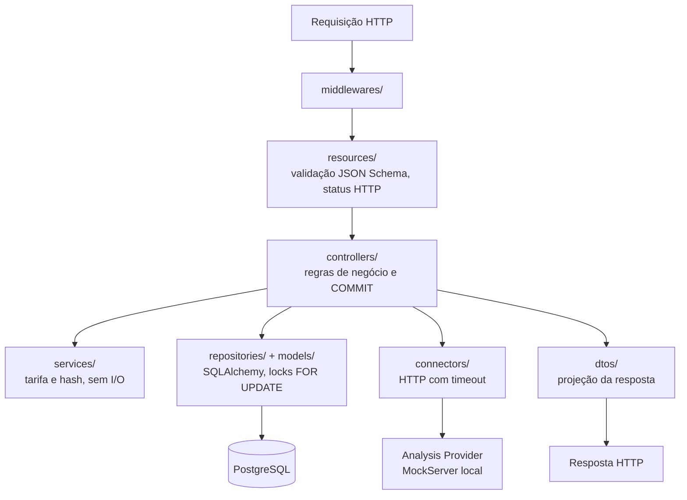
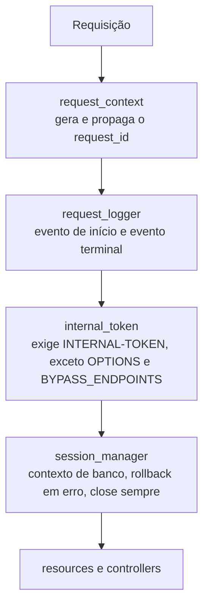
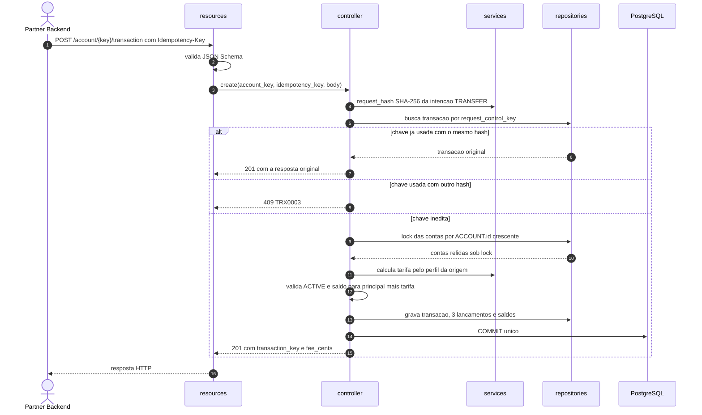

# Arquitetura — BaaS Simplificado

**Bootcamp QI Tech 2026** · **Autores:** João Vitor Miranda Sousa · Mohamad Ahmad Barakat

**Documentos relacionados:** [RFC](RFC.md) · [ROTAS](ROTAS.md) · [ERD](ERD.md) · [FLUXOS](FLUXOS.md) · [Segurança](SEGURANCA.md) · [CI e DevSecOps](CI-DEVSECOPS.md)

Este documento descreve como o código em `src/` está organizado e onde ficam as decisões transacionais. Os nomes de arquivos e funções citados existem no repositório.

## Sumário

1. [Visão geral](#1-visão-geral)
2. [Camadas e responsabilidades](#2-camadas-e-responsabilidades)
3. [Middlewares](#3-middlewares)
4. [Fronteira transacional e locks](#4-fronteira-transacional-e-locks)
5. [Sequência de uma transferência](#5-sequência-de-uma-transferência)
6. [Integrações externas](#6-integrações-externas)
7. [Organização dos testes](#7-organização-dos-testes)
8. [Pontos de atenção](#8-pontos-de-atenção)

## 1. Visão geral

A aplicação é um serviço **FastAPI** que persiste em **PostgreSQL** via **SQLAlchemy**, valida entradas com **JSON Schema** e consulta um provedor de análise cadastral por **HTTP**. A requisição atravessa as camadas de fora para dentro:

## 2. Camadas e responsabilidades

| Caminho | Responsabilidade |
|---|---|
| `src/app.py` | Monta a aplicação: registra os quatro middlewares, as rotas R01–R10 e `GET /`, e os *error handlers*. `main()` executa `check_variables()`, `error_verification()` e `setup_logging()` antes de criar a app. Habilita `/docs`, `/redoc` e `/openapi.json` somente quando `APP_ENV` é `local` ou `test`. |
| `src/constants.py` | Configuração lida do ambiente: `INTERNAL_TOKEN`, `DATABASE_URL`, timeouts de banco, URLs dos provedores e `BYPASS_ENDPOINTS` (`/` e `/health_check`). |
| `src/database.py` | Engine e sessão SQLAlchemy, contexto de banco por requisição (`contextvars`) e aplicação de `connect_timeout`, `lock_timeout` e `statement_timeout` em cada conexão. |
| `src/middlewares/` | `request_context`, `request_logger`, `internal_token` e `session_manager` (ver [§3](#3-middlewares)). |
| `src/resources/` | Camada HTTP: `client`, `client_analysis`, `account`, `transaction` e `health_check`. Valida o corpo/query, chama o controller e define o status da resposta. |
| `src/controllers/` | Regras de negócio e fronteira transacional. `base_controller` fornece sessão, contexto e logger. |
| `src/services/` | Funções puras, sem banco nem framework: `transfer_fee.py` (tarifa PF/PJ com `HALF_UP`) e `transaction_hash.py` (SHA-256 da intenção canônica). |
| `src/repositories/` | Consultas e escritas via SQLAlchemy, locks `FOR UPDATE` e resolução entre o texto das enumerações e as tabelas de lookup. |
| `src/models/` | Models ORM das 8 tabelas de domínio e das 7 lookups. |
| `src/dtos/` | Projeções de resposta; não expõem IDs internos `BIGINT`. |
| `src/errors/` | `QIException`, catálogo de erros por domínio e handlers que produzem o envelope `{title, description, translation, code}`. `error_verification()` impede códigos duplicados no startup. |
| `src/schemas/` | JSON Schemas das rotas com corpo e da query do extrato. |
| `src/connectors/` | Clientes HTTP de serviços externos (ver [§6](#6-integrações-externas)). |
| `src/utils/` | Logger estruturado, identificador de requisição, classificação de timeouts de banco por SQLSTATE, validação de documentos e integração com JSON Schema. |

### Por que `services/` é separado

`transfer_fee.py` e `transaction_hash.py` não dependem de banco, sessão nem FastAPI. Ficar fora de `controllers/` evita que um controller importe outro módulo do mesmo pacote apenas para reutilizar lógica, e permite testá-los isoladamente (`tests/unit/test_transaction_fee.py`, `test_transaction_hash.py`, `test_transfer_fee_invariants.py`). `tests/unit/test_services_layer_boundary.py` garante que os módulos antigos `controllers.transaction_fee` e `controllers.transaction_hash` não existem mais e que o controller usa as funções de `services`.

Valores codificados em `src/services/transfer_fee.py`:

| Perfil da origem | `rate_bps` | Mínimo (centavos) | Máximo (centavos) |
|---|---:|---:|---:|
| `INDIVIDUAL` | 50 | 50 | 1.000 |
| `COMPANY` | 100 | 100 | 1.500 |

Tarifa proporcional: `(amount_cents * rate_bps + 5000) // 10000` (aritmética inteira com `HALF_UP`), depois limitada ao intervalo `[mínimo, máximo]`.

## 3. Middlewares

O Starlette executa primeiro o último middleware registrado. Em `src/app.py`, o registro é `session_manager`, `internal_token`, `request_logger`, `request_context`; a ordem efetiva de processamento é a inversa:

- O `request_id` existe antes do primeiro log da requisição.
- O log fica antes do token, então tentativas recusadas com `403` também são registradas.
- A sessão de banco é a camada mais interna: requisições sem token não chegam a abrir sessão.
- `session_manager` **nunca** faz `commit`; ele só faz `rollback` em exceção e fecha a sessão.

## 4. Fronteira transacional e locks

O fluxo financeiro está em `src/controllers/transaction_controller.py`:

- **`create()`** é o método público da R07. Ele valida a `Idempotency-Key`, calcula o `request_hash`, consulta uma transação existente e despacha para `_create_deposit` ou `_create_transfer`.
- Os métodos privados retornam a `transaction_key` (`UUID`) quando prepararam uma operação nova, ou a resposta original (`dict`) quando se trata de replay. **Eles não fazem `commit`.**
- `create()` faz **um único `self.session.commit()`** quando recebe uma `transaction_key` nova; no replay, devolve a resposta sem confirmar nada.
- Qualquer exceção leva a `self.session.rollback()` e é relançada. Uma colisão na constraint `financial_transaction_request_control_key_key` (`IntegrityError`) também faz rollback e relê a transação vencedora.

Locks:

- **Depósito:** `AccountRepository.get_by_key_for_update` trava a conta com `SELECT ... FOR UPDATE`.
- **Transferência:** `AccountRepository.get_by_ids_for_update` recebe os IDs ordenados (`sorted(...)`) e consulta com `ORDER BY account.id` e `FOR UPDATE`. A ordem fixa por `ACCOUNT.id` evita deadlock entre transferências em sentidos opostos.
- As duas consultas usam `populate_existing()`, então status e saldo são revalidados com os valores lidos **depois** do lock. Saldo insuficiente (`TRX0001`) é detectado antes de qualquer escrita.
- `lock_timeout` (padrão 3 s) e `statement_timeout` (padrão 10 s) limitam esperas por lock e consultas longas.

`tests/integration/transaction/r07_safety/test_commit_boundary.py` cobre o commit único, o replay sem commit e o rollback em falha.

## 5. Sequência de uma transferência

Os demais fluxos (cadastro, análise, depósito, extrato, concorrência) estão em [FLUXOS.md](FLUXOS.md).

## 6. Integrações externas

- `src/connectors/rest_connector.py` é a base dos clientes HTTP. O `timeout` é obrigatório no construtor e sempre repassado ao `requests`; o header `INTERNAL-TOKEN` só é enviado quando o connector recebe um token.
- `client_analysis_connector.py` chama `POST /v1/client-analysis` no Analysis Provider (`ANALYSIS_PROVIDER_URL`). Localmente e no CI, esse provedor é o MockServer; o connector não envia token.
- `bankslip_connector.py` está exportado em `connectors/__init__.py`, mas nenhuma rota ou controller o utiliza; boletos estão fora do escopo.

## 7. Organização dos testes

| Pasta | Conteúdo |
|---|---|
| `tests/unit/` | Funções puras (tarifa, hash), fronteira de `services` e carga do JSON de inicialização do MockServer |
| `tests/integration/contracts/` | Contratos HTTP transversais: token, `404`/`405`, UUID malformado e envelope de erro |
| `tests/integration/client/r01`–`r09` | Rotas de cliente e conta, incluindo atomicidade e concorrência (R04, R06, R09) |
| `tests/integration/transaction/` | R07 e R08: depósitos, transferências, tarifas, idempotência, concorrência, caminhos negativos e extrato; `r07_safety/` cobre atomicidade, histórico e fronteira de commit |
| `tests/integration/database/` | Schema, lookups, timeouts e migração de banco populado (`test_populated_migration.py`) |
| `tests/integration/test_*.py` | Healthcheck, observabilidade (ausência de dados sensíveis nos logs) e exposição OpenAPI |
| `tests/utils/` | Cliente HTTP de teste, controle do MockServer, geradores de dados e `db_utils` |

A maior parte dos testes de integração usa apenas HTTP. Alguns acessam o banco diretamente quando precisam de um estado que a API não produz (conta `INACTIVE` ou `CLOSED`, saldo próximo do limite, datas retroativas) ou para verificar persistência e atomicidade.

## 8. Pontos de atenção

- `create()` concentra parsing, idempotência, despacho e commit; é o método mais complexo do projeto.
- Ler o `APP_ENV` diretamente do ambiente no gating de documentação é intencional: `constants.APP_ENV` tem fallback `"local"`, que reabriria a documentação quando a variável estivesse ausente.
- `bankslip_connector` é código sem uso nas rotas atuais.
