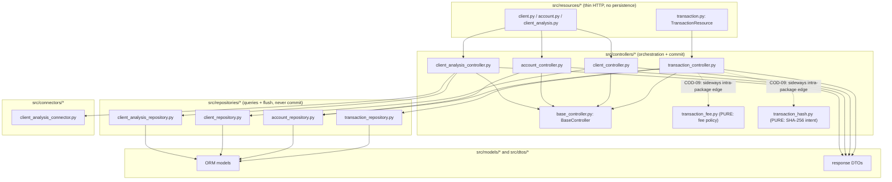
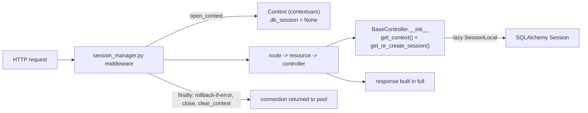

# P1-C Architecture and Transaction Audit

Read-only "before" audit for the P1-C refactor
(`refactor/p1c-layer-boundaries-transactions`, branched off `main` at
`a0217be`). This document records the current (pre-refactor) state of two
findings, COD-09 (layer boundary) and COD-11 (transactional control), with
concrete file and symbol references, a dependency map, and a full inventory of
every commit / rollback / flush / lock. It makes no source-code change; later
features (FEAT-002..FEAT-005) perform the refactor that this audit justifies.

All line numbers below were read directly from the tree at the branch point and
are quoted so the later refactor can be checked against them.

## Baseline

| Measurement | Value | How it was measured |
| --- | --- | --- |
| Total tests collected | **506** | `.venv/bin/python -m pytest --collect-only -q \| tail -1` from repo root reports `506 tests collected`. |
| Host-runnable unit tests | **23 passed** | `cd src && ../.venv/bin/python -m pytest ../tests/unit -q` reports `23 passed`. |
| Remaining tests | 483 | Collected but require the full Docker/CI stack (two separate Postgres clusters, MockServer, live uvicorn). |

**Docker is unavailable in the development sandbox** (`docker info` fails; the
CI workflow comment itself states "O Docker esta quebrado na sandbox de
desenvolvimento"). Therefore the host can only run `tests/unit` end to end; the
integration, contract, database-schema, transaction, healthcheck, and
observability suites run only in GitHub Actions CI
(`.github/workflows/ci.yml`), which is the authoritative green signal for this
task. The refactor must keep collection at 506 (no test lost) while the host
unit count may grow as new pure unit tests are added by later features.

## Section 1: COD-09 diagnosis (layer boundary)

### The finding

`src/controllers/transaction_controller.py` imports two sibling modules that
live **inside** the `controllers` package but are not controllers:

```python
# src/controllers/transaction_controller.py, lines 8-13
from controllers.base_controller import BaseController
from controllers.transaction_fee import calculate_transfer_fee_cents
from controllers.transaction_hash import (
    build_deposit_request_hash,
    build_transfer_request_hash,
)
```

- Line 8 (`controllers.base_controller`) is a legitimate controller-to-base
  dependency.
- Lines 9-13 are the COD-09 edge: a controller reaching **sideways** into
  `controllers.transaction_fee` and `controllers.transaction_hash`, two modules
  that are pure functions, not controllers.

These two modules are genuinely pure (no session, no I/O, no `BaseController`):

- `src/controllers/transaction_fee.py` -- pure transfer-fee policy.
  `calculate_transfer_fee_cents(amount_cents, client_type)` applies the
  per-profile rate in basis points with HALF_UP rounding plus floor and cap
  (`TRANSFER_FEE_PROFILES`: INDIVIDUAL 50 bps, min 50, max 1000; COMPANY 100
  bps, min 100, max 1500). It imports only `typing.NamedTuple`.
- `src/controllers/transaction_hash.py` -- pure SHA-256 intent
  canonicalization and hashing. `canonicalize_deposit_request`,
  `build_deposit_request_hash`, `canonicalize_transfer_request`, and
  `build_transfer_request_hash`. It imports only `hashlib.sha256` and
  `uuid.UUID`.

The problem is placement, not content: pure domain helpers sit in the
`controllers` package and are consumed as if they were shared services, which
blurs the layer boundary (a reader expects a `controllers.*` import to be a
controller). The package's own `__init__.py` confirms the intent: it exports
only the four controller classes and never re-exports the fee/hash modules:

```python
# src/controllers/__init__.py
from controllers.client_controller import ClientController
from controllers.client_analysis_controller import ClientAnalysisController
from controllers.account_controller import AccountController
from controllers.transaction_controller import TransactionController
```

### The other three controllers are clean

The three non-transaction controllers import only
`controllers.base_controller` from within the `controllers` package (every
other import is from `dtos`, `errors`, `models`, `repositories`, `connectors`,
or `utils`):

- `src/controllers/client_controller.py` -> `from controllers.base_controller import BaseController` (line 8).
- `src/controllers/account_controller.py` -> `from controllers.base_controller import BaseController` (line 8).
- `src/controllers/client_analysis_controller.py` -> `from controllers.base_controller import BaseController` (line 5).

So `transaction_controller` is the only controller with a sideways
intra-package import, which is what makes COD-09 a localized, low-risk move.

### The tests pin the current import path

Two host unit tests import the pure modules by their current
`controllers.*` path and will need their import path updated when the modules
move (FEAT-002/FEAT-003):

- `tests/unit/test_transaction_fee.py` -> `from controllers.transaction_fee import calculate_transfer_fee_cents`.
- `tests/unit/test_transaction_hash.py` -> `from controllers.transaction_hash import (build_deposit_request_hash, build_transfer_request_hash, canonicalize_deposit_request, canonicalize_transfer_request)`.

### Required negative findings (COD-09 scope sweep)

The user instruction asked for these explicit "nothing else wrong here"
confirmations. Each was checked against the current source:

- **(a) No controller instantiates or calls another controller.** Searched all
  four controllers: none constructs or invokes `ClientController`,
  `AccountController`, `ClientAnalysisController`, or `TransactionController`.
  Controllers compose only repositories (and, in the analysis case, a
  connector). The only cross-controller-package import is the fee/hash edge
  above.
- **(b) Duplicated business rules: none found** beyond the fee/hash modules
  being treated as controllers. Fee policy exists once
  (`transaction_fee.py`); intent hashing exists once (`transaction_hash.py`);
  the HALF_UP / floor / cap constants are not re-implemented anywhere else.
- **(c) HTTP resources do no persistence.** `src/resources/transaction.py`
  (`TransactionResource.on_post` / `on_get_list`) only instantiates
  `TransactionController`, calls `create` / `get_statement`, and wraps the
  result in a `JSONResponse`. No `session`, `commit`, `flush`, `add`, or query
  anywhere in the resource. The other resources follow the same thin pattern.
- **(d) Repositories hold no business orchestration.** `TransactionRepository`
  and `AccountRepository` issue queries and `session.add` + `session.flush`
  only; neither calls `session.commit()` and neither contains branching
  business policy. All decisions (status checks, amount limits, fee, locking
  order) live in the controller.
- **(e) No circular dependencies or shared mutable state** beyond the
  per-request `Context`. The dependency direction is strictly
  resources -> controllers -> repositories/connectors -> models/dtos. The only
  shared mutable object is the per-request `Context` (`src/database.py`),
  carried via `contextvars` and documented as by-design; it is created fresh
  per request by `open_context()` and torn down by `clear_context()`.

## Section 2: COD-11 diagnosis (transactional control)

### The finding

`transaction_controller` performs its `session.commit()` inside a **private
helper**, not in the public route-serving method:

```python
# src/controllers/transaction_controller.py
def _commit_and_build_response(self, transaction_key: UUID) -> dict:
    self.session.commit()
    persisted_transaction = (
        self.transaction_repository.get_by_key_with_entries(
            transaction_key
        )
    )
    return TransactionDTO.obj_to_response(persisted_transaction)
```

`_commit_and_build_response` is called by the two private flow methods
`_create_deposit` (its last statement:
`return self._commit_and_build_response(transaction_key)`) and
`_create_transfer` (its last statement: same call). Both are reached only
through the public `create(...)` method. So the actual `commit()` is **two call
levels below** the public entry point, and the public `create` method contains
no visible `commit`.

### The asymmetry (the concrete COD-11 divergence)

Every other controller commits as the **last statement of the public method**
that serves the route:

- `src/controllers/client_controller.py`
  - `create`: `self.session.commit()` is the last persistence step inside the
    `try` block, immediately before returning `response_data` (the response
    dict is captured before commit because commit expires ORM attributes).
  - `update_status`: `self.session.commit()` immediately precedes
    `return response` at the end of the public method.
- `src/controllers/account_controller.py`
  - `create_for_client`: `self.session.commit()` then `return response`,
    last step of the public method.
  - `update_status`: `self.session.commit()` then `return response`.
- `src/controllers/client_analysis_controller.py`
  - `analyze`: `self.session.commit()` then `return response_data`, last step
    of the public method (it also issues an intentional `self.session.rollback()`
    earlier to end the read transaction before the external HTTP call -- see
    Section 4).

`transaction_controller` is the odd one out: the commit is hidden in
`_commit_and_build_response`, so a reader scanning the public `create` method
cannot see where (or whether) the write is persisted. **The divergence is
purely about visibility and placement of the commit, not about correctness:**
the commit is still the single, final persistence step of each flow (proven in
Section 4). FEAT-004 will lift the commit so it becomes the visible last
persistence step of the transaction flow, matching the other three
controllers, while preserving the single atomic commit.

## Section 3: "Before" dependency map

### Layered call graph



The dotted edges are the COD-09 problem: `transaction_controller` reaches
sideways into `controllers.transaction_fee` and `controllers.transaction_hash`,
which belong one layer "below" controllers (pure domain logic) but physically
reside in the `controllers` package.

### Context / session flow (database.py and middlewares)



Key points from `src/database.py` and `src/middlewares/session_manager.py`:

- `open_context()` creates a fresh empty `Context` per request and stores it in
  a `ContextVar`; `clear_context()` removes it in the middleware `finally`.
- The session is lazy: `Context.get_or_create_session()` calls `SessionLocal()`
  only when a controller is constructed (`BaseController.__init__` ->
  `get_context()` + `get_or_create_session()`), so routes that build no
  controller (`/` and `/health_check`) never open a session.
- The middleware **never commits**. It only `rollback()`s on an unexpected
  exception (guarded by `if context.db_session is not None`) and always
  `close()`s + `clear_context()` in `finally`. Commit ownership belongs to the
  controller by design.

## Section 4: "Before" transactional inventory

### Complete enumeration of commit / rollback / flush / lock / history writes

**`src/middlewares/session_manager.py`** (session lifecycle, never commits)

| Operation | Location | Notes |
| --- | --- | --- |
| `rollback()` | `except Exception` branch, guarded by `if context.db_session is not None` | Only on unexpected errors; expected domain errors become handled responses before reaching here. |
| `close()` | `finally`, guarded by `if context.db_session is not None` | Always; returns the connection to the pool. |
| `clear_context()` | `finally` | Always; removes the per-request context. |
| commit | none | Deliberate; long docstring explains why the middleware must not commit. |

**`src/database.py`** -- defines `Context`, `get_context`, `open_context`,
`clear_context`, `SessionLocal` (`autoflush=False`), and the engine. No
`commit` / `rollback` / `flush` / lock here; it only wires the session.

**`src/repositories/transaction_repository.py`**

| Operation | Method | Notes |
| --- | --- | --- |
| `session.add` + `session.flush()` | `create_transaction` | flush assigns the PK; no commit. |
| `session.add` (no flush) | `create_entry` | ledger entry buffered. |
| read only | `list_statement_entries`, `get_by_key_with_entries`, `get_by_request_control_key_with_entries` | queries only. |

**`src/repositories/account_repository.py`**

| Operation | Method | Notes |
| --- | --- | --- |
| `with_for_update(of=Account)` | `get_by_key_for_update`, `get_by_ids_for_update`, `get_account_by_key_for_update` | SELECT FOR UPDATE row locks. |
| `with_for_update(of=Client)` | `get_client_by_key_for_update`, `get_client_by_id_for_update` | SELECT FOR UPDATE row locks. |
| attribute mutation (no flush/commit) | `update_balance` | sets `balance_cents` and `updated_at` on the managed ORM object. |
| `session.add` + `session.flush()` | `create_account` | flush assigns the PK. |
| `session.add` (no flush) | `create_initial_status_event`, `create_account_status_event`, `create_client_status_event` | status/history rows buffered. |
| commit | none | Repositories never commit. |

**Controllers -- commit / rollback ownership**

| Controller / public method | commit site | rollback site |
| --- | --- | --- |
| `transaction_controller.create` (deposit/transfer) | `self.session.commit()` inside private `_commit_and_build_response` (COD-11) | `self.session.rollback()` in the outer `except Exception`; also on idempotency-collision replay (`_is_idempotency_key_collision`); also on replay detected inside `_create_deposit` / `_create_transfer`. |
| `client_controller.create` | `self.session.commit()` last persistence step before `return` | `self.session.rollback()` in `except IntegrityError`. |
| `client_controller.update_status` | `self.session.commit()` before `return response` | `self.session.rollback()` in outer `except Exception`. |
| `account_controller.create_for_client` | `self.session.commit()` before `return response` | `self.session.rollback()` in `except IntegrityError` and outer `except Exception`. |
| `account_controller.update_status` | `self.session.commit()` before `return response` | `self.session.rollback()` in outer `except Exception`. |
| `client_analysis_controller.analyze` | `self.session.commit()` before `return response_data` | `self.session.rollback()` intentionally issued to end the read transaction before the external HTTP call. |

### Financial flows R07 (deposit and transfer): where the transaction begins and who commits

**R07 deposit (`_create_deposit`)**

1. Transaction begins at the first `SELECT ... FOR UPDATE`:
   `account_repository.get_by_key_for_update(account_key)` locks the account
   row.
2. A replay check follows (`_get_existing_response`); on replay it
   `session.rollback()`s (releasing the lock) and returns the stored response.
3. Writes (all buffered, no intermediate commit): `create_transaction`
   (flush), one CREDIT/PRINCIPAL `create_entry`, and `update_balance`.
4. **Commit owner:** `_commit_and_build_response` issues the single
   `session.commit()` as the last persistence step, then re-reads the
   transaction for the response DTO.

**R07 transfer (`_create_transfer`)**

1. Resolve both account ids (`get_ids_by_keys`), then transaction begins at the
   first `SELECT ... FOR UPDATE`:
   `account_repository.get_by_ids_for_update(sorted(ids))` -- locks are taken in
   **ascending `Account.id` order** (the `sorted(...)` plus `order_by(Account.id)`
   in the repository), which is the deadlock-avoidance invariant.
2. Replay check -> on replay, `session.rollback()` and return stored response.
3. Status + amount + fee checks; `fee_cents` via
   `calculate_transfer_fee_cents` (the COD-09 import); overflow and
   insufficient-balance guards.
4. Writes (buffered, no intermediate commit): `create_transaction` (flush),
   three `create_entry` rows (source DEBIT/PRINCIPAL, source DEBIT/FEE, target
   CREDIT/PRINCIPAL), and two `update_balance` calls (source then target).
5. **Commit owner:** `_commit_and_build_response` issues the single
   `session.commit()` as the last persistence step.

### The five COD-11 questions, answered

1. **Where does each operation's transaction begin and end?**
   Begin: the first `SELECT ... FOR UPDATE` (deposit:
   `get_by_key_for_update`; transfer: `get_by_ids_for_update`), which is also
   the first write-intent of the flow. End: the single `session.commit()` in
   `_commit_and_build_response`, or a `session.rollback()` (on replay, on
   idempotency collision, or on any unexpected exception in the outer
   `except`). For the other controllers the begin is their first
   `*_for_update` read (or first `add`) and the end is their public-method
   `commit` / `except` `rollback`.

2. **Which component commits?** Always the **controller**, never the
   repository and never the middleware. For transactions the commit is nested
   inside the private `_commit_and_build_response`; for client/account/analysis
   it is the visible last statement of the public method. This nesting is the
   COD-11 inconsistency.

3. **Do premature, duplicate, or partial commits exist today?** **No.** Each
   financial flow has exactly one `session.commit()`, reached only after all
   reads, policy checks, and buffered writes succeed. There is no commit inside
   repositories, no commit in the middleware, and no commit between the
   individual `create_entry` / `update_balance` calls. A failure before the
   single commit leaves everything buffered and is discarded by rollback (outer
   `except` in the controller, and the middleware `finally` as a backstop). So
   there is no code path that could persist a half-applied transfer.

4. **Are the financial effects and the history atomic?** **Yes.** The balance
   mutations (`update_balance`) and the ledger/history rows (the
   `create_transaction` + `create_entry` writes, plus the idempotency control
   key stored on `FinancialTransaction.request_control_key`) are all buffered
   in the same session and flushed/committed together by the one
   `session.commit()`. They succeed or fail as a unit; the unique constraint on
   the idempotency key (`financial_transaction_request_control_key_key`) is
   enforced in the same transaction, which is how concurrent duplicate requests
   collapse to one winner.

5. **Does the reorganization need an explicit application-layer transaction
   boundary?** **No new boundary is required.** The single implicit
   transaction (opened by the first locking read, closed by the one commit) is
   already correct and atomic. COD-11 is only about **visibility**: FEAT-004
   should move the existing `session.commit()` up so it is the visible last
   persistence step of the transaction flow (as in the other three
   controllers), without adding a second commit, without wrapping anything in a
   new `begin()`/context-manager, and without changing where the transaction
   starts or ends. The deliberate `rollback()`-before-external-HTTP in
   `client_analysis.analyze` and the `rollback()`-on-replay in the deposit and
   transfer flows must be preserved exactly.

## Conclusion

Both findings are localized and low-risk:

- **COD-09** is a placement problem: two pure modules
  (`controllers/transaction_fee.py`, `controllers/transaction_hash.py`) live in
  the `controllers` package and are imported sideways by
  `transaction_controller.py` (lines 9-13). Moving them to a non-controller
  (services) package and updating the two importers plus the two unit tests
  resolves it with no behavior change.
- **COD-11** is a visibility problem: the single, already-atomic
  `session.commit()` is hidden in the private helper
  `_commit_and_build_response`. Making it the visible last persistence step of
  the public flow aligns `transaction_controller` with `client_controller`,
  `account_controller`, and `client_analysis_controller`, again with no
  behavior change.

No premature, duplicate, or partial commits exist today, and all financial and
historical effects are already atomic, so the refactor preserves every invariant
while improving layer boundaries and transactional readability.
