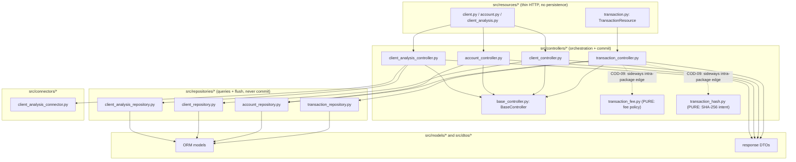
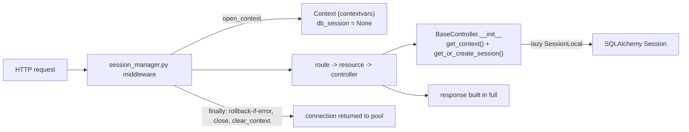
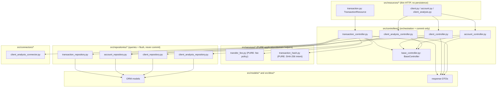

# P1-C Architecture and Transaction Audit

Read-only "before" audit for the P1-C refactor
(`refactor/p1c-layer-boundaries-transactions`, branched off `main` at
`a0217be`). This document records the current (pre-refactor) state of two
findings, COD-09 (layer boundary) and COD-11 (transactional control), with
concrete file and symbol references, a dependency map, and a full inventory of
every commit / rollback / flush / lock. It makes no source-code change; later
features (FEAT-002..FEAT-005) perform the refactor that this audit justifies.

All line numbers below were read directly from the tree at the branch point and
are quoted so the later refactor can be checked against them.

## Baseline

| Measurement | Value | How it was measured |
| --- | --- | --- |
| Total tests collected | **506** | `.venv/bin/python -m pytest --collect-only -q \| tail -1` from repo root reports `506 tests collected`. |
| Host-runnable unit tests | **23 passed** | `cd src && ../.venv/bin/python -m pytest ../tests/unit -q` reports `23 passed`. |
| Remaining tests | 483 | Collected but require the full Docker/CI stack (two separate Postgres clusters, MockServer, live uvicorn). |

**Docker is unavailable in the development sandbox** (`docker info` fails; the
CI workflow comment itself states "O Docker esta quebrado na sandbox de
desenvolvimento"). Therefore the host can only run `tests/unit` end to end; the
integration, contract, database-schema, transaction, healthcheck, and
observability suites run only in GitHub Actions CI
(`.github/workflows/ci.yml`), which is the authoritative green signal for this
task. The refactor must keep collection at 506 (no test lost) while the host
unit count may grow as new pure unit tests are added by later features.

## Section 1: COD-09 diagnosis (layer boundary)

### The finding

`src/controllers/transaction_controller.py` imports two sibling modules that
live **inside** the `controllers` package but are not controllers:

```python
# src/controllers/transaction_controller.py, lines 8-13
from controllers.base_controller import BaseController
from controllers.transaction_fee import calculate_transfer_fee_cents
from controllers.transaction_hash import (
    build_deposit_request_hash,
    build_transfer_request_hash,
)
```

- Line 8 (`controllers.base_controller`) is a legitimate controller-to-base
  dependency.
- Lines 9-13 are the COD-09 edge: a controller reaching **sideways** into
  `controllers.transaction_fee` and `controllers.transaction_hash`, two modules
  that are pure functions, not controllers.

These two modules are genuinely pure (no session, no I/O, no `BaseController`):

- `src/controllers/transaction_fee.py` -- pure transfer-fee policy.
  `calculate_transfer_fee_cents(amount_cents, client_type)` applies the
  per-profile rate in basis points with HALF_UP rounding plus floor and cap
  (`TRANSFER_FEE_PROFILES`: INDIVIDUAL 50 bps, min 50, max 1000; COMPANY 100
  bps, min 100, max 1500). It imports only `typing.NamedTuple`.
- `src/controllers/transaction_hash.py` -- pure SHA-256 intent
  canonicalization and hashing. `canonicalize_deposit_request`,
  `build_deposit_request_hash`, `canonicalize_transfer_request`, and
  `build_transfer_request_hash`. It imports only `hashlib.sha256` and
  `uuid.UUID`.

The problem is placement, not content: pure domain helpers sit in the
`controllers` package and are consumed as if they were shared services, which
blurs the layer boundary (a reader expects a `controllers.*` import to be a
controller). The package's own `__init__.py` confirms the intent: it exports
only the four controller classes and never re-exports the fee/hash modules:

```python
# src/controllers/__init__.py
from controllers.client_controller import ClientController
from controllers.client_analysis_controller import ClientAnalysisController
from controllers.account_controller import AccountController
from controllers.transaction_controller import TransactionController
```

### The other three controllers are clean

The three non-transaction controllers import only
`controllers.base_controller` from within the `controllers` package (every
other import is from `dtos`, `errors`, `models`, `repositories`, `connectors`,
or `utils`):

- `src/controllers/client_controller.py` -> `from controllers.base_controller import BaseController` (line 8).
- `src/controllers/account_controller.py` -> `from controllers.base_controller import BaseController` (line 8).
- `src/controllers/client_analysis_controller.py` -> `from controllers.base_controller import BaseController` (line 5).

So `transaction_controller` is the only controller with a sideways
intra-package import, which is what makes COD-09 a localized, low-risk move.

### The tests pin the current import path

Two host unit tests import the pure modules by their current
`controllers.*` path and will need their import path updated when the modules
move (FEAT-002/FEAT-003):

- `tests/unit/test_transaction_fee.py` -> `from controllers.transaction_fee import calculate_transfer_fee_cents`.
- `tests/unit/test_transaction_hash.py` -> `from controllers.transaction_hash import (build_deposit_request_hash, build_transfer_request_hash, canonicalize_deposit_request, canonicalize_transfer_request)`.

### Required negative findings (COD-09 scope sweep)

The user instruction asked for these explicit "nothing else wrong here"
confirmations. Each was checked against the current source:

- **(a) No controller instantiates or calls another controller.** Searched all
  four controllers: none constructs or invokes `ClientController`,
  `AccountController`, `ClientAnalysisController`, or `TransactionController`.
  Controllers compose only repositories (and, in the analysis case, a
  connector). The only cross-controller-package import is the fee/hash edge
  above.
- **(b) Duplicated business rules: none found** beyond the fee/hash modules
  being treated as controllers. Fee policy exists once
  (`transaction_fee.py`); intent hashing exists once (`transaction_hash.py`);
  the HALF_UP / floor / cap constants are not re-implemented anywhere else.
- **(c) HTTP resources do no persistence.** `src/resources/transaction.py`
  (`TransactionResource.on_post` / `on_get_list`) only instantiates
  `TransactionController`, calls `create` / `get_statement`, and wraps the
  result in a `JSONResponse`. No `session`, `commit`, `flush`, `add`, or query
  anywhere in the resource. The other resources follow the same thin pattern.
- **(d) Repositories hold no business orchestration.** `TransactionRepository`
  and `AccountRepository` issue queries and `session.add` + `session.flush`
  only; neither calls `session.commit()` and neither contains branching
  business policy. All decisions (status checks, amount limits, fee, locking
  order) live in the controller.
- **(e) No circular dependencies or shared mutable state** beyond the
  per-request `Context`. The dependency direction is strictly
  resources -> controllers -> repositories/connectors -> models/dtos. The only
  shared mutable object is the per-request `Context` (`src/database.py`),
  carried via `contextvars` and documented as by-design; it is created fresh
  per request by `open_context()` and torn down by `clear_context()`.

## Section 2: COD-11 diagnosis (transactional control)

### The finding

`transaction_controller` performs its `session.commit()` inside a **private
helper**, not in the public route-serving method:

```python
# src/controllers/transaction_controller.py
def _commit_and_build_response(self, transaction_key: UUID) -> dict:
    self.session.commit()
    persisted_transaction = (
        self.transaction_repository.get_by_key_with_entries(
            transaction_key
        )
    )
    return TransactionDTO.obj_to_response(persisted_transaction)
```

`_commit_and_build_response` is called by the two private flow methods
`_create_deposit` (its last statement:
`return self._commit_and_build_response(transaction_key)`) and
`_create_transfer` (its last statement: same call). Both are reached only
through the public `create(...)` method. So the actual `commit()` is **two call
levels below** the public entry point, and the public `create` method contains
no visible `commit`.

### The asymmetry (the concrete COD-11 divergence)

Every other controller commits as the **last statement of the public method**
that serves the route:

- `src/controllers/client_controller.py`
  - `create`: `self.session.commit()` is the last persistence step inside the
    `try` block, immediately before returning `response_data` (the response
    dict is captured before commit because commit expires ORM attributes).
  - `update_status`: `self.session.commit()` immediately precedes
    `return response` at the end of the public method.
- `src/controllers/account_controller.py`
  - `create_for_client`: `self.session.commit()` then `return response`,
    last step of the public method.
  - `update_status`: `self.session.commit()` then `return response`.
- `src/controllers/client_analysis_controller.py`
  - `analyze`: `self.session.commit()` then `return response_data`, last step
    of the public method (it also issues an intentional `self.session.rollback()`
    earlier to end the read transaction before the external HTTP call -- see
    Section 4).

`transaction_controller` is the odd one out: the commit is hidden in
`_commit_and_build_response`, so a reader scanning the public `create` method
cannot see where (or whether) the write is persisted. **The divergence is
purely about visibility and placement of the commit, not about correctness:**
the commit is still the single, final persistence step of each flow (proven in
Section 4). FEAT-004 will lift the commit so it becomes the visible last
persistence step of the transaction flow, matching the other three
controllers, while preserving the single atomic commit.

## Section 3: "Before" dependency map

### Layered call graph



The dotted edges are the COD-09 problem: `transaction_controller` reaches
sideways into `controllers.transaction_fee` and `controllers.transaction_hash`,
which belong one layer "below" controllers (pure domain logic) but physically
reside in the `controllers` package.

### Context / session flow (database.py and middlewares)



Key points from `src/database.py` and `src/middlewares/session_manager.py`:

- `open_context()` creates a fresh empty `Context` per request and stores it in
  a `ContextVar`; `clear_context()` removes it in the middleware `finally`.
- The session is lazy: `Context.get_or_create_session()` calls `SessionLocal()`
  only when a controller is constructed (`BaseController.__init__` ->
  `get_context()` + `get_or_create_session()`), so routes that build no
  controller (`/` and `/health_check`) never open a session.
- The middleware **never commits**. It only `rollback()`s on an unexpected
  exception (guarded by `if context.db_session is not None`) and always
  `close()`s + `clear_context()` in `finally`. Commit ownership belongs to the
  controller by design.

## Section 4: "Before" transactional inventory

### Complete enumeration of commit / rollback / flush / lock / history writes

**`src/middlewares/session_manager.py`** (session lifecycle, never commits)

| Operation | Location | Notes |
| --- | --- | --- |
| `rollback()` | `except Exception` branch, guarded by `if context.db_session is not None` | Only on unexpected errors; expected domain errors become handled responses before reaching here. |
| `close()` | `finally`, guarded by `if context.db_session is not None` | Always; returns the connection to the pool. |
| `clear_context()` | `finally` | Always; removes the per-request context. |
| commit | none | Deliberate; long docstring explains why the middleware must not commit. |

**`src/database.py`** -- defines `Context`, `get_context`, `open_context`,
`clear_context`, `SessionLocal` (`autoflush=False`), and the engine. No
`commit` / `rollback` / `flush` / lock here; it only wires the session.

**`src/repositories/transaction_repository.py`**

| Operation | Method | Notes |
| --- | --- | --- |
| `session.add` + `session.flush()` | `create_transaction` | flush assigns the PK; no commit. |
| `session.add` (no flush) | `create_entry` | ledger entry buffered. |
| read only | `list_statement_entries`, `get_by_key_with_entries`, `get_by_request_control_key_with_entries` | queries only. |

**`src/repositories/account_repository.py`**

| Operation | Method | Notes |
| --- | --- | --- |
| `with_for_update(of=Account)` | `get_by_key_for_update`, `get_by_ids_for_update`, `get_account_by_key_for_update` | SELECT FOR UPDATE row locks. |
| `with_for_update(of=Client)` | `get_client_by_key_for_update`, `get_client_by_id_for_update` | SELECT FOR UPDATE row locks. |
| attribute mutation (no flush/commit) | `update_balance` | sets `balance_cents` and `updated_at` on the managed ORM object. |
| `session.add` + `session.flush()` | `create_account` | flush assigns the PK. |
| `session.add` (no flush) | `create_initial_status_event`, `create_account_status_event`, `create_client_status_event` | status/history rows buffered. |
| commit | none | Repositories never commit. |

**Controllers -- commit / rollback ownership**

| Controller / public method | commit site | rollback site |
| --- | --- | --- |
| `transaction_controller.create` (deposit/transfer) | `self.session.commit()` inside private `_commit_and_build_response` (COD-11) | `self.session.rollback()` in the outer `except Exception`; also on idempotency-collision replay (`_is_idempotency_key_collision`); also on replay detected inside `_create_deposit` / `_create_transfer`. |
| `client_controller.create` | `self.session.commit()` last persistence step before `return` | `self.session.rollback()` in `except IntegrityError`. |
| `client_controller.update_status` | `self.session.commit()` before `return response` | `self.session.rollback()` in outer `except Exception`. |
| `account_controller.create_for_client` | `self.session.commit()` before `return response` | `self.session.rollback()` in `except IntegrityError` and outer `except Exception`. |
| `account_controller.update_status` | `self.session.commit()` before `return response` | `self.session.rollback()` in outer `except Exception`. |
| `client_analysis_controller.analyze` | `self.session.commit()` before `return response_data` | `self.session.rollback()` intentionally issued to end the read transaction before the external HTTP call. |

### Financial flows R07 (deposit and transfer): where the transaction begins and who commits

**R07 deposit (`_create_deposit`)**

1. Transaction begins at the first `SELECT ... FOR UPDATE`:
   `account_repository.get_by_key_for_update(account_key)` locks the account
   row.
2. A replay check follows (`_get_existing_response`); on replay it
   `session.rollback()`s (releasing the lock) and returns the stored response.
3. Writes (all buffered, no intermediate commit): `create_transaction`
   (flush), one CREDIT/PRINCIPAL `create_entry`, and `update_balance`.
4. **Commit owner:** `_commit_and_build_response` issues the single
   `session.commit()` as the last persistence step, then re-reads the
   transaction for the response DTO.

**R07 transfer (`_create_transfer`)**

1. Resolve both account ids (`get_ids_by_keys`), then transaction begins at the
   first `SELECT ... FOR UPDATE`:
   `account_repository.get_by_ids_for_update(sorted(ids))` -- locks are taken in
   **ascending `Account.id` order** (the `sorted(...)` plus `order_by(Account.id)`
   in the repository), which is the deadlock-avoidance invariant.
2. Replay check -> on replay, `session.rollback()` and return stored response.
3. Status + amount + fee checks; `fee_cents` via
   `calculate_transfer_fee_cents` (the COD-09 import); overflow and
   insufficient-balance guards.
4. Writes (buffered, no intermediate commit): `create_transaction` (flush),
   three `create_entry` rows (source DEBIT/PRINCIPAL, source DEBIT/FEE, target
   CREDIT/PRINCIPAL), and two `update_balance` calls (source then target).
5. **Commit owner:** `_commit_and_build_response` issues the single
   `session.commit()` as the last persistence step.

### The five COD-11 questions, answered

1. **Where does each operation's transaction begin and end?**
   Begin: the first `SELECT ... FOR UPDATE` (deposit:
   `get_by_key_for_update`; transfer: `get_by_ids_for_update`), which is also
   the first write-intent of the flow. End: the single `session.commit()` in
   `_commit_and_build_response`, or a `session.rollback()` (on replay, on
   idempotency collision, or on any unexpected exception in the outer
   `except`). For the other controllers the begin is their first
   `*_for_update` read (or first `add`) and the end is their public-method
   `commit` / `except` `rollback`.

2. **Which component commits?** Always the **controller**, never the
   repository and never the middleware. For transactions the commit is nested
   inside the private `_commit_and_build_response`; for client/account/analysis
   it is the visible last statement of the public method. This nesting is the
   COD-11 inconsistency.

3. **Do premature, duplicate, or partial commits exist today?** **No.** Each
   financial flow has exactly one `session.commit()`, reached only after all
   reads, policy checks, and buffered writes succeed. There is no commit inside
   repositories, no commit in the middleware, and no commit between the
   individual `create_entry` / `update_balance` calls. A failure before the
   single commit leaves everything buffered and is discarded by rollback (outer
   `except` in the controller, and the middleware `finally` as a backstop). So
   there is no code path that could persist a half-applied transfer.

4. **Are the financial effects and the history atomic?** **Yes.** The balance
   mutations (`update_balance`) and the ledger/history rows (the
   `create_transaction` + `create_entry` writes, plus the idempotency control
   key stored on `FinancialTransaction.request_control_key`) are all buffered
   in the same session and flushed/committed together by the one
   `session.commit()`. They succeed or fail as a unit; the unique constraint on
   the idempotency key (`financial_transaction_request_control_key_key`) is
   enforced in the same transaction, which is how concurrent duplicate requests
   collapse to one winner.

5. **Does the reorganization need an explicit application-layer transaction
   boundary?** **No new boundary is required.** The single implicit
   transaction (opened by the first locking read, closed by the one commit) is
   already correct and atomic. COD-11 is only about **visibility**: FEAT-004
   should move the existing `session.commit()` up so it is the visible last
   persistence step of the transaction flow (as in the other three
   controllers), without adding a second commit, without wrapping anything in a
   new `begin()`/context-manager, and without changing where the transaction
   starts or ends. The deliberate `rollback()`-before-external-HTTP in
   `client_analysis.analyze` and the `rollback()`-on-replay in the deposit and
   transfer flows must be preserved exactly.

## Conclusion

Both findings are localized and low-risk:

- **COD-09** is a placement problem: two pure modules
  (`controllers/transaction_fee.py`, `controllers/transaction_hash.py`) live in
  the `controllers` package and are imported sideways by
  `transaction_controller.py` (lines 9-13). Moving them to a non-controller
  (services) package and updating the two importers plus the two unit tests
  resolves it with no behavior change.
- **COD-11** is a visibility problem: the single, already-atomic
  `session.commit()` is hidden in the private helper
  `_commit_and_build_response`. Making it the visible last persistence step of
  the public flow aligns `transaction_controller` with `client_controller`,
  `account_controller`, and `client_analysis_controller`, again with no
  behavior change.

No premature, duplicate, or partial commits exist today, and all financial and
historical effects are already atomic, so the refactor preserves every invariant
while improving layer boundaries and transactional readability.

## Section 5: "After" dependency map

The refactor (FEAT-002/FEAT-003) moved the two pure modules out of the
`controllers` package into a new non-controller `services` package and lifted
the transaction commit to the public `create()` method (FEAT-003). The two
pure modules now live at `src/services/transfer_fee.py` and
`src/services/transaction_hash.py`; the `controllers` package contains only
controllers plus `base_controller.py`.



The dotted "sideways intra-package" edges from Section 3 are gone: the
`controllers` -> `services` edges are now a clean downward dependency from the
orchestration layer to the pure domain-helper layer. `transaction_controller`
imports the helpers from their new home:

```python
# src/controllers/transaction_controller.py, lines 9-13 (after)
from services.transfer_fee import calculate_transfer_fee_cents
from services.transaction_hash import (
    build_deposit_request_hash,
    build_transfer_request_hash,
)
```

The `controllers` package no longer contains any non-controller module; the two
legacy paths `controllers.transaction_fee` and `controllers.transaction_hash`
no longer resolve (pinned by a parametrized unit test, Section 9). The
`controllers/__init__.py` export set is unchanged (it always exported only the
four controller classes). The Context / session flow diagram from Section 3 is
unchanged: `src/database.py` and `src/middlewares/session_manager.py` were not
touched, so the lazy session, the contextvars lifecycle, and the
"middleware never commits" rule all stand exactly as audited.

## Section 6: "After" transactional inventory

COD-11 is resolved: the single `session.commit()` for the financial flows is
now a **visible line in the public `create()` method**, not nested in a private
helper. The private helper `_commit_and_build_response` was removed. The two
private flows (`_create_deposit`, `_create_transfer`) now return a `UUID` (the
staged transaction key) on new work, or a `dict` (the idempotent replay
response) on replay; neither commits. The public `create()` inspects the
result:

```python
# src/controllers/transaction_controller.py, inside create() (after)
# Replay short-circuit: the private flow already rolled back the
# lock-select transaction and produced the idempotent response, so
# there is no new work to persist and nothing to commit.
if not isinstance(result, UUID):
    return result

# A brand-new transaction was staged (entries + balances flushed but
# not committed). Commit here so the transaction boundary is visible
# at the public controller method, then build the 201 response from a
# post-commit re-read (commit expires the ORM attributes).
transaction_key = result
self.session.commit()
return self._build_response(transaction_key)
```

So there is still **exactly one commit per successful op**, reached only after
all locking reads, policy checks, and buffered writes succeed. The
`_build_response` helper does the post-commit re-read + DTO projection (the same
read that `_commit_and_build_response` used to do, minus the commit). The
replay and `IntegrityError` paths are unchanged in effect:

- **Replay** (`_get_existing_response` returns a stored response inside the
  private flow): the private flow issues its `session.rollback()` to release the
  lock-select transaction and returns the stored `dict`; `create()` sees a
  non-`UUID` result and returns it with no commit. No new work is persisted.
- **Idempotency-key collision** (`IntegrityError` with the unique-constraint
  name): caught in `create()`, `session.rollback()`, re-read the winner via
  `_get_existing_response`, return it. No new work is persisted.
- **Any other exception**: the outer `except Exception` in `create()` issues
  `session.rollback()` and re-raises, so a failure before the single commit
  discards all buffered writes.

### Commit-location table (before -> after), per controller

| Controller / public method | Commit location BEFORE | Commit location AFTER | Changed? |
| --- | --- | --- | --- |
| `transaction_controller.create` (deposit/transfer) | inside private `_commit_and_build_response` (two call levels below the public method) | visible `self.session.commit()` in the public `create()` body, right before `return self._build_response(...)` | **Yes (COD-11)** |
| `client_controller.create` | `self.session.commit()` last persistence step before `return` | unchanged | No |
| `client_controller.update_status` | `self.session.commit()` before `return response` | unchanged | No |
| `account_controller.create_for_client` | `self.session.commit()` before `return response` | unchanged | No |
| `account_controller.update_status` | `self.session.commit()` before `return response` | unchanged | No |
| `client_analysis_controller.analyze` | `self.session.commit()` before `return response_data` (with the intentional pre-HTTP `rollback()`) | unchanged | No |
| `src/middlewares/session_manager.py` | never commits | never commits | No |
| `src/database.py` Context lifecycle | lazy session, contextvars, no commit | unchanged | No |

Only `transaction_controller` changed. All other commit/rollback sites,
including the deliberate `rollback()`-before-external-HTTP in
`client_analysis.analyze`, are byte-for-byte as audited in Section 4.

## Section 7: Technical justification

### Why a `services` package (not controllers, not deeper layers)

`transfer_fee.py` (fee policy) and `transaction_hash.py` (SHA-256 intent
canonicalization) are **pure functions**: no session, no I/O, no
`BaseController`, no ORM. They were physically inside `controllers` but are not
controllers, which is exactly the COD-09 boundary smell (a reader expects a
`controllers.*` import to be a controller). Three options were weighed:

1. **Leave them in `controllers`.** Rejected: it keeps the layer-boundary
   violation that COD-09 flags, and keeps `transaction_controller` importing
   sideways from its own package for logic that is not a controller.
2. **Invent a deeper stack** (separate `domain/`, `policies/`, `application/`
   layers, value objects, a fee-strategy hierarchy, etc.). Rejected under the
   user's explicit "no artificial layers / no over-abstraction" guardrail:
   two small pure modules do not justify a multi-layer taxonomy, and inventing
   one would add indirection with no behavior or testability gain.
3. **One flat `services` package** (chosen). A single non-controller
   application/domain-helper package is the minimal move that fixes the
   boundary: the pure helpers get a home that is clearly *not* the controller
   layer, `transaction_controller` now depends **downward** on
   `services.*` instead of **sideways** within `controllers`, and nothing else
   in the dependency graph changes. The name `services` is a convention choice
   (see Section 11); the import root stays `src/` so the path is
   `from services.transfer_fee import ...` with no `src.` prefix, matching the
   repo's import rooting.

### The COD-11 approach (and why commits were kept out of the middleware)

COD-11 was purely a **visibility/placement** problem, not a correctness one
(Section 4 proved the single commit was already atomic). The fix therefore
changes only where the existing commit is written, not how many there are or
when the transaction begins/ends:

- **Commit visible at the public boundary.** The one `session.commit()` is now
  a line in the public `create()` method, so a reader scanning the route-serving
  method can see exactly where the write is persisted. This aligns
  `transaction_controller` with the other three controllers, which all commit
  as the last persistence step of their public method.
- **Exactly one commit per successful op.** No commit was added, duplicated, or
  moved between the individual `create_entry` / `update_balance` calls. The
  transaction still begins at the first `SELECT ... FOR UPDATE` and ends at the
  single commit (or a rollback), exactly as before.
- **Middleware still never commits.** Moving the commit **into** the middleware
  was explicitly avoided per the user's instruction. The middleware's job is
  session lifecycle (rollback-on-unexpected-error, close, clear_context); giving
  it commit ownership would (a) take the atomic boundary away from the component
  that holds the business invariants, (b) commit even for read-only routes or
  partially-built responses, and (c) contradict the long docstring in
  `session_manager.py` that documents why the middleware must not commit. Commit
  ownership stays with the controller.
- **`database.py` Context lifecycle unchanged.** No change to `SessionLocal`,
  the lazy-session creation, the contextvars-based `Context`, or
  open/clear_context. The refactor did not need a new application-layer
  transaction boundary (no `begin()` wrapper, no context manager): the existing
  implicit transaction was already correct.

## Section 8: Evidence of preserved invariants

Each required invariant maps to the test(s) that cover it. The r07_safety,
concurrency, and idempotency suites are the pre-existing authority; the new
`test_commit_boundary.py` adds explicit boundary assertions. (The pure
fee/boundary invariants also run on the host; the rest require the Docker/CI
stack.)

| Invariant | Covering test(s) |
| --- | --- |
| Money in integer cents (no floats) | `tests/unit/test_transaction_fee.py`, `tests/unit/test_transfer_fee_invariants.py`, and every `*_cents` assertion in `r07_safety/test_commit_boundary.py` / `test_atomicity.py`. |
| PF fee 0.50% min 50 max 1000 | `tests/unit/test_transfer_fee_invariants.py` (floor-just-below-threshold -> 50, cap -> 1000, HALF_UP at exact .5c -> 102); `tests/unit/test_transaction_fee.py` (parametrized); integration fee-250-for-50000-PF in `r07_safety/test_atomicity.py` and `r07_safety/test_commit_boundary.py` (`fee_cents == 250`). |
| PJ fee 1.00% min 100 max 1500 | `tests/unit/test_transfer_fee_invariants.py` (floor -> 100, cap -> 1500, HALF_UP at exact .5c -> 202); `tests/unit/test_transaction_fee.py`. |
| HALF_UP rounding | `tests/unit/test_transfer_fee_invariants.py` (exact half-cent boundary cases for PF and PJ). |
| Idempotency-Key UUID + SHA-256 intent hash | `tests/unit/test_transaction_hash.py`; `tests/integration/transaction/.../test_r07_idempotency_concurrency.py`, `test_r07_transfer_idempotency.py`. |
| Idempotent replay (same intent -> same body, no new work) | `r07_safety/test_commit_boundary.py::test_idempotent_replay_returns_same_body_and_commits_no_new_work`; `r07_safety/test_history.py`; `test_r07_transfer_idempotency.py`. |
| Idempotency conflict (same key, different intent -> 409 TRX0003, no new work) | `r07_safety/test_commit_boundary.py::test_incompatible_key_reuse_returns_409_and_persists_no_new_work`. |
| Failed attempt does not consume the idempotency key | `r07_safety/test_atomicity.py` (failed-attempt-does-not-consume-key case). |
| Account locks taken in ascending ACCOUNT.id order | `r07_safety/test_atomicity.py` (lock-timeout case); `test_r07_financial_concurrency.py`; `account_repository.get_by_ids_for_update(sorted(ids))`. |
| No negative balance (insufficient-balance rejected) | `test_r07_financial_concurrency.py`; `r07_safety/test_atomicity.py`. |
| Atomicity of source/dest/fee/history/idempotency as one unit | `r07_safety/test_commit_boundary.py` (exactly 1 transaction + 3 entries + both balances, single commit) and `r07_safety/test_atomicity.py` (exact 3-entry transfer). |
| Full rollback on failure (before and at commit; deferred-commit failure) | `r07_safety/test_atomicity.py` (rollback-before/at-commit, deferred-commit-failure cases). |
| Statement dates / ordering / pagination / timezone | `r07_safety/test_history.py` and the statement/contract suites under `tests/integration/transaction` and `tests/integration/contracts`. |
| MockServer cadastral integration | the client-analysis integration suite driving `client_analysis_connector` against MockServer. |
| HTTP contracts and RFC error codes | `tests/integration/contracts/*`; `r07_safety/test_commit_boundary.py` (asserts HTTP 201 and 409 with `code == "TRX0003"`). |
| Single-commit deposit (1 transaction + 1 entry, committed balance) | `r07_safety/test_commit_boundary.py::test_successful_deposit_commits_exactly_one_transaction_and_entry`. |
| Concurrency correctness (duplicate requests collapse to one winner) | `test_r07_financial_concurrency.py`, `test_r07_idempotency_concurrency.py`, `test_r07_transfer_fee.py`. |

## Section 9: New tests (FEAT-004)

FEAT-004 added **15 new tests** across three files. 11 are pure unit tests
(host-runnable); 4 are integration tests (Docker/CI-only). Each is additive and
does not weaken or duplicate existing assertions.

**`tests/unit/test_services_layer_boundary.py` (5 pure unit tests, COD-09)**

1. `test_services_fee_and_hash_modules_import` -- the pure fee/hash modules are
   importable from their new canonical home `services.*`.
2. `test_legacy_controller_modules_no_longer_exist[controllers.transaction_fee]`
   -- parametrized: importing the old `controllers.transaction_fee` path raises
   `ModuleNotFoundError` (the move is complete, not a copy).
3. `test_legacy_controller_modules_no_longer_exist[controllers.transaction_hash]`
   -- parametrized sibling: the old `controllers.transaction_hash` path no longer
   resolves.
4. `test_transaction_controller_resolves_fee_from_services` -- the controller's
   `calculate_transfer_fee_cents` is the exact `services.transfer_fee` function
   (no local shadow copy).
5. `test_transaction_controller_resolves_hashes_from_services` -- the
   controller's deposit/transfer hash builders are the exact
   `services.transaction_hash` functions.

**`tests/unit/test_transfer_fee_invariants.py` (6 pure unit tests, R07 fee borders)**

6. `test_individual_charges_floor_just_below_min_fee_threshold` -- PF floor:
   amount just below the 10_000 threshold is raised to the 50-cent minimum.
7. `test_individual_charges_cap_on_large_amount` -- PF cap: a large amount is
   limited to the 1_000-cent maximum.
8. `test_company_charges_floor_just_below_min_fee_threshold` -- PJ floor: just
   below threshold is raised to the 100-cent minimum.
9. `test_company_charges_cap_on_large_amount` -- PJ cap: large amount limited to
   the 1_500-cent maximum.
10. `test_individual_rounds_half_up_at_exact_half_cent_boundary` -- PF HALF_UP:
    20_300 yields 101.5c proportional, rounded up to 102.
11. `test_company_rounds_half_up_at_exact_half_cent_boundary` -- PJ HALF_UP:
    20_150 yields 201.5c proportional, rounded up to 202.

**`tests/integration/transaction/r07_safety/test_commit_boundary.py` (4 integration tests, COD-11; Docker/CI only)**

12. `test_successful_deposit_commits_exactly_one_transaction_and_entry` --
    single-commit deposit: HTTP 201, exactly 1 transaction + 1 CREDIT/PRINCIPAL
    entry, committed balance 50_000.
13. `test_successful_transfer_commits_exactly_one_transaction_and_three_entries`
    -- single-commit transfer: HTTP 201, `fee_cents == 250` (PF 0.50% of 50_000),
    exactly 1 transaction + 3 entries (source PRINCIPAL/FEE + target PRINCIPAL),
    both final balances.
14. `test_idempotent_replay_returns_same_body_and_commits_no_new_work` --
    idempotent replay: identical 201 body, row counts and `updated_at` unchanged
    (no new work committed).
15. `test_incompatible_key_reuse_returns_409_and_persists_no_new_work` --
    incompatible key reuse (different amount, different target): 409 `TRX0003`,
    original transaction intact, no new work persisted.

**Suite total: 506 + 15 = 521 tests collected.**

## Section 10: Local results and environment

| Measurement | Baseline (pre-P1-C) | After P1-C | How measured |
| --- | --- | --- | --- |
| Total tests collected | 506 | **521** (506 + 15 new) | `.venv/bin/python -m pytest --collect-only -q \| tail -1` from repo root. |
| Host-runnable unit tests passing | 23 | **34** (23 + 11 new pure unit tests) | `cd src && ../.venv/bin/python -m pytest ../tests/unit -q`. |
| Tests requiring Docker/CI | 483 | 487 (483 + 4 new integration tests) | Not host-runnable; collected only. |

The 4 new tests in `r07_safety/test_commit_boundary.py` are
integration/CI-only. **Docker is unavailable in this sandbox**, so the full
integration suite (including those 4) runs only in GitHub Actions CI
(`.github/workflows/ci.yml`), which is the authoritative green signal. There is
**no lint step in CI**; the sole gate is pytest. The host run above confirms the
34 pure unit tests pass and collection stays at 521 (no test lost, the delta is
exactly the 15 new tests).

**CI is authoritative.** The orchestrator supplies the final GitHub Actions run
link and the validated commit SHA after pushing the branch:

- CI / Actions run: _PLACEHOLDER (orchestrator fills after push)_
- Validated commit SHA: _PLACEHOLDER (orchestrator fills after push)_

## Section 11: Remaining pendencies and risks

- **Full integration suite not executed locally.** Docker is unavailable in the
  sandbox, so the 487 integration/contract/database/transaction/healthcheck/
  observability tests (including the 4 new commit-boundary tests) were validated
  only by collection locally; their green signal comes from CI. This is the
  documented environment constraint, not a defect.
- **No DB remodeling.** P1-C intentionally made zero schema/table/column/enum/
  migration changes (`database/database.sql` untouched). Any data-model
  follow-ups are deferred to P1-D by design.
- **`services` package name is a convention choice.** A flat non-controller
  helper package was chosen (Section 7); the name could equally be `domain` or
  `application` in a future convention pass. No behavior depends on the name,
  only the import path `services.*`.
- **No behavior change claimed, verified only at unit level + collection here.**
  The observable-API-unchanged guarantee for the HTTP flows rests on the
  unchanged integration suite passing in CI; confirm the CI run is green before
  merging.
